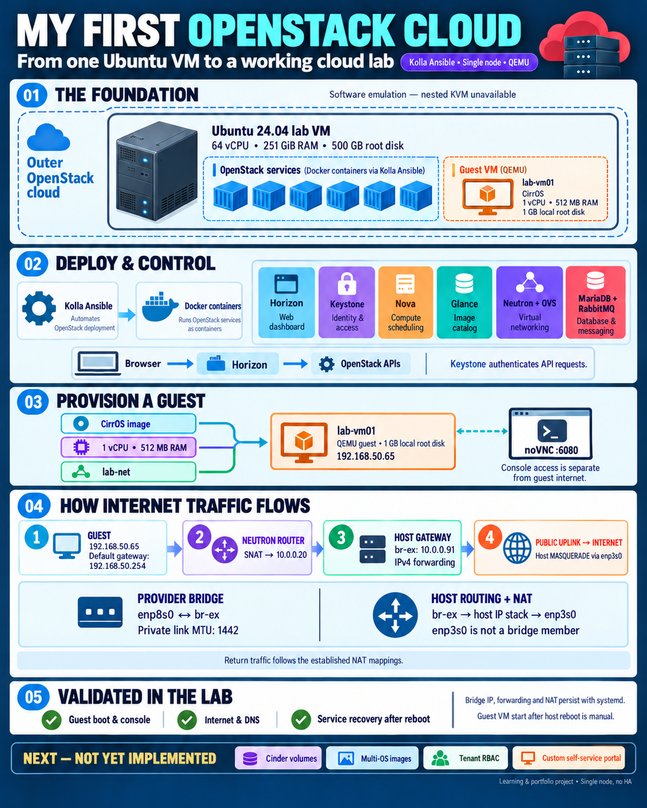

# ☁️ OpenStack Cloud Lab
### One Ubuntu VM → a working OpenStack environment

**Nova · Neutron · Open vSwitch · Glance · Keystone · Horizon**

[🚀 Start Here](START-HERE.md) · [🗺️ Architecture](docs/01-architecture.md) · [📚 Guides](#-read-in-this-order) · [🔧 Troubleshooting](docs/09-troubleshooting.md)

---

## 👋 What is this project?

A **single-node OpenStack lab inside an existing cloud VM**. Kolla Ansible manages Docker-based OpenStack services, and Nova provisions guests using **QEMU software emulation** because nested KVM is unavailable.

This project follows the complete path from an Ubuntu server to a usable cloud: deployment, APIs, images, virtual networks, routers, guest boot, browser console, outbound NAT and reboot recovery.

> 💡 Outer cloud = existing provider platform. Lab host = Ubuntu VM named `horizon`. Inner cloud = our Kolla deployment. Guest = `lab-vm01` inside the inner cloud.

> ⚠️ A learning environment with custom host NAT and one failure domain. **Not a production or HA deployment template.**

## 🖼️ Architecture at a glance

[Understand the exact packet path →](docs/01-architecture.md)

## ✅ Verified progress

| Capability | Result |
|---|---|
| Kolla deployment | Successful play recap; no failed/unreachable tasks |
| Core services | Healthy containers; Nova services and Neutron agents UP |
| Horizon | Dashboard login and instance management verified |
| QEMU instance | CirrOS guest boot and console login verified |
| Internal networking | DHCP lease and local connectivity verified |
| Guest internet + DNS | Passed before the final clean host reboot |
| Persistent host NAT | Bridge IP, forwarding and NAT restored by systemd |
| Clean reboot recovery | Core services recovered without manual service restarts after the proxy startup fix |
| Guest after final reboot | Manually started; API reported ACTIVE / Running |
| Final guest network repeat | **Pending:** latest pings were run on the outer host, not inside the guest |
| Cinder / extra images / custom portal | **Future work, not implemented** |

## 🧱 Lab inventory

These are observed specifications, **not minimum requirements**.

| Item | Configuration |
|---|---|
| Host OS | Ubuntu 24.04 LTS, x86_64 |
| Resources | 64 vCPU, approximately 251 GiB RAM |
| Root disk | 500 GB virtual disk; approximately 484 GB filesystem |
| Topology | Control + network + compute on one host |
| Virtualization | QEMU; no usable `/dev/kvm` |
| Public / management NIC | `enp3s0` |
| Provider NIC | `enp8s0`, OVS `br-ex` member |
| Host gateway | `10.0.0.91/24` on `br-ex` |
| Guest network | `192.168.50.0/24` |
| Inner router | Internal `192.168.50.254`; external/SNAT `10.0.0.20` |
| Test guest | CirrOS, 1 vCPU, 512 MB RAM, 1 GB local root disk |
| Endpoint design | Management host IP; no separate VIP; top-level proxies disabled |

Real public addresses, account IDs, port UUIDs and credentials are omitted. `192.0.2.10` is a **documentation-only address**, not a working endpoint.

## 📚 Read in this order

| Phase | Guide | Outcome |
|---|---|---|
| 0 | [GitHub browser setup](START-HERE.md) | Create repo, upload folders and preview |
| 1 | [Architecture](docs/01-architecture.md) | Understand components and flows |
| 2 | [VM and networking](docs/02-vm-and-network.md) | Inspect capacity and configure NICs |
| 3 | [Installation](docs/03-installation.md) | Venv, Kolla, dependencies and inventory |
| 4 | [Configure and deploy](docs/04-configuration-and-deploy.md) | QEMU, MTU, passwords and deployment |
| 5 | [First instance](docs/05-first-instance.md) | Image, flavor, network and guest |
| 6 | [Router and host NAT](docs/06-router-and-host-nat.md) | Working outbound packet path |
| 7 | [Reboot persistence](docs/07-reboot-persistence.md) | Persist bridge, forwarding and NAT |
| 8 | [Operations and verification](docs/08-operations-and-verification.md) | Health, APIs, guest and reboot checks |
| 9 | [Troubleshooting](docs/09-troubleshooting.md) | Real failures and corrected approaches |
| 10 | [Roadmap](docs/10-roadmap.md) | Cinder, image catalog, RBAC and portal |

## 🧪 How to read commands

| Label | Meaning |
|---|---|
| 🔎 Inspect | Read-only diagnostics |
| 🛠️ Change | Installs software, writes files or creates resources |
| 🔄 Service impact | Stops/restarts services or reboots |
| 🖥️ HOST | Outer Ubuntu VM, typically root |
| 🐧 GUEST | Inside `lab-vm01` through its console |
| 🌐 LAPTOP / PORTAL | Local computer or specified web portal |

**Copy commands only, not prompts or expected output.** `root@horizon` is the host; the guest hostname is `lab-vm01`. A Python venv does not switch you into the guest.

## 🔐 Publishing checklist

- Upload this sanitized bundle, **not `/etc/kolla` or `/root`**.
- Never upload passwords, clouds/OpenRC files, keys or tokens.
- Manually inspect browser uploads; `.gitignore` is not a substitute.
- Remove console tokens, public IPs and provider/client identifiers from screenshots.
- Rotate the admin credential exposed during the learning session before wider access.
- Read [SECURITY.md](SECURITY.md).

## 🧠 What this lab taught me

1. Dashboard availability does not prove compute/network/storage health.
2. No nested KVM does not prevent a functional QEMU learning lab.
3. A subnet gateway field does not create a router interface.
4. An outer reservation port does not automatically fix nested return traffic.
5. Container health and OpenStack service heartbeats are separate checks.
6. Stopping a container does not disable its systemd boot service.
7. Host/service recovery and automatic guest startup are different features.

## 📌 Boundaries

**Implemented:** one-node control/compute, CirrOS guest, noVNC, DHCP, outbound host NAT and clean service recovery.

**Not implemented:** Cinder, public inbound access per guest, verified tenant isolation, multi-OS templates, custom portal, TLS hardening, backups or HA.

[🎯 Roadmap](docs/10-roadmap.md) · [📖 References](docs/11-references.md) · [📝 Change log](CHANGELOG.md)
